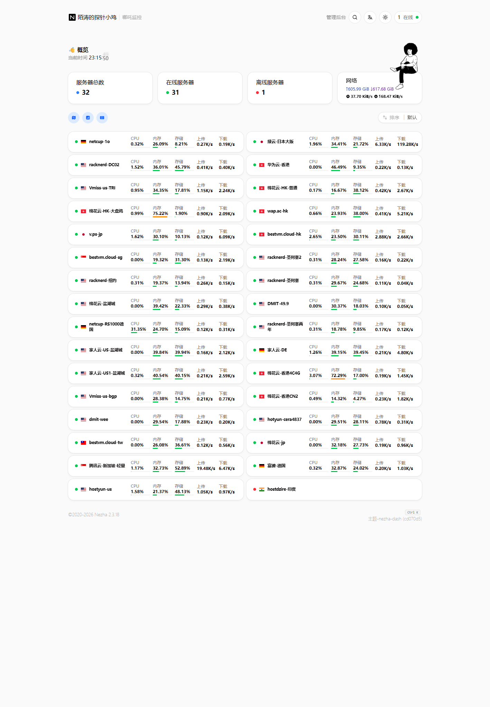

# 服务器监控面板横向对比（2026-10-20）

对象：`cdn.nat.tf`（实测）＋ 7 个开源项目（源码结构与文档）。
目的：为 Rollcall 找可借鉴的设计，并明确"哪些不要抄"。

---

## 一、cdn.nat.tf 实测

| 项 | 实测结果 |
|---|---|
| 产品 | 哪吒监控 **v2.3.18**（与自己那台 43.156.17.202 同版本） |
| 站点 | 名称"陌涛的探针小鸡"，32 台节点，31 在线 / 1 离线 |
| 主题 | `user_template=user-dist`（**nezha-dash** `cd070d5`），`admin_template=admin-dist` |
| 登录 | `POST /api/v1/login` → JWT 走 `nz-jwt` Cookie，另发 `nz-csrf`（双 Cookie 防 CSRF） |
| API 前缀 | `/api/v1/*`（gRPC-gateway 风格），另有 `/api/v1/ws/server` 做实时推送 |
| 站点设置 | `language / site_name / custom_code / install_host / user_template / admin_template / cover / ip_change_notification_group_id` |



**首页信息结构**（nezha-dash）：

```
顶部：站点名 · 管理后台 · 搜索(Ctrl K) · 语言 · 主题 · 在线计数
概览：4 张汇总卡 —— 服务器总数 / 在线 / 离线 / 网络(累计 ↑↓ + 实时速率 ↑↓)
筛选：地区圆点行
排序：默认 / 名称 / 运行时间 / 系统 / CPU / 内存 / 磁盘 / 上传 / 下载
卡片：每台一行五指标 —— CPU% · 内存% · 存储% · 上传速率 · 下载速率
页脚：©2020-2026 Nezha 2.3.18 · 主题-nezha-dash(cd070d5)
```

**数据模型（关键）**：`GET /api/v1/server` 每台返回

```
host{platform, platform_version, cpu[], mem_total, disk_total, arch,
     virtualization, boot_time, version}
state{cpu, mem_used, disk_used, net_in_speed, net_out_speed,
      net_in_transfer, net_out_transfer, uptime,
      tcp_conn_count, udp_conn_count, process_count}
geoip{...}  last_active  display_index
```

两个观察：

1. **`state` 是覆盖式"当前态"**，不是时间序列。历史走 `/api/v1/server/{id}/metrics?range=`。
   实时与历史彻底分开：列表页一次拉全量当前态，不碰历史表。
2. **没有 `online` 字段**，在线与否由前端用 `last_active` 与当前时间算。
   好处是服务端"零状态判断"，坏处是每个客户端都要实现同一套阈值逻辑（哪吒用 30s 上报 + 阈值）。

**可借鉴的三点**：`custom_code` 允许注入 CSS/JS 改皮肤（该站就用它隐藏了地图与顶栏）；主题以目录形式分发（`user-dist`），可在后台切换；实时推送走 WebSocket 而不是轮询。

---

## 二、七个项目

### 1. naiba/nezha — 事实标准（Go 1.26 / Gin / gRPC / VictoriaMetrics）
- 结构：`cmd / model / pkg / proto / service / integration`；`pkg` 下 `grpcx / websocketx / tsdb / ddns / geoip / i18n / agentcompatcontract`
- 采集：Agent 双向 gRPC 长连接（不是纯 HTTP 上报），服务端可下发任务（exec、自定义监控、NAT 探测）；`agentcompatcontract` 明确做 agent 兼容性契约
- 存储：**VictoriaMetrics** 作为时序库（v0 是 SQLite），另存 `state` 当前态
- 告警：规则 + 通知模板（多渠道、模板变量），支持 Cron/DDNS/服务探测
- UI：前后端分离，`user-dist` / `admin-dist` 双前端，主题可换（nezha-dash 是社区主题）
- 评价：功能最全、生态最大（10.3k star）；代价是**重**——gRPC + TSDB + 双向指令通道，部署与安全面都更大。Agent 能被下发命令，这是 Rollcall 明确不做的。

### 2. komari-monitor/komari — 轻量化的主流选择（Go 1.25 / Gin / Goja / 三库）
- 结构：`cmd / database / internal / pkg / utils / web`；`internal` 下 `metricstore / notifications / plugin / scheduler / migrations / sqlitetune / lifecycle`
- 采集：Agent → Hub，**1 秒级实时展示**；`gorilla/websocket` 推前端
- 存储：SQLite / MySQL / PostgreSQL 三选一（`mattn/go-sqlite3` 需 CGO）；`sqlitetune` 专门调 PRAGMA
- 告警：`notifications` 包（离线/到期为主）
- 扩展：**Goja（纯 Go 的 JS 运行时）做插件**，主题市场 + 插件机制
- UI：独立 `komari-web` 仓库，主题/插件可装
- 评价：功能密度与依赖数平衡得最好，6.4k star；有 Web 终端（`internal` 里带终端能力），属"监控 + 运维"混合定位。

### 3. nuomiiiii/Lite — komari 的运维向分支（Go 1.26）
- README 明确"基于 komari 持续开发"；`go.mod` 依赖与 komari 高度重合（gin / goja / 同版本 sqlite/pgx/mysql）
- 增量包：`migrations / expiry / execschedule / selfupdate / themehttp / thememanifest / trafficreset / corn`
- 功能增量：定时远程执行、远程终端、文件管理、**MCP 代理（AI 授权管理服务器）**、成本中心/续费日历、多路告警渠道 + 告警汇总推送、丢包/延迟双阈值告警（自适应/固定基线）
- 存储优化：README 主打"低配置主控上的数据库占用、历史查询与维护负载"
- 评价：面向"一个人管几十台小鸡"的真实运维流程做得最细（续费、成本、定时任务）；但远程执行/终端与 MCP 让攻击面比纯监控大一个量级。

### 4. xjetry/heron — 与 Rollcall 理念最接近（Go 1.27 / Connect / CBOR / 纯 Go）
- 结构：`cmd / internal / proto / gen / web / deploy / docs`；`internal` 下 `agent / agentconfig / agentwire / hub / hubclient / releasesig / update / probelimit / netaddr / netguard 类组件 / sqlitetest / testwait`
- 协议：**connectrpc/connect**（HTTP/JSON + gRPC 兼容）+ **CBOR**（比 JSON 省，且无 schema 漂移）+ `proto/`
- 依赖：WebAuthn（硬件密钥登录）、maxminddb（GeoIP）、purego（避免 CGO）
- 安全设计（写进 README 的"硬承诺"）：
  - agent 只读采集；hub 每次应答能影响 agent 的**只有四件事**：上报节奏（限幅）、探测任务（目标受本地策略约束）、出口地址探测的逐族开关、签名更新任务
  - 更新器只接受**官方发行签名**的正式版本，新版本未确认就绪会自动回滚
  - 公开页主题**在沙箱中运行，拿不到管理会话**
  - 预授权 API token 给 AI/脚本用，权限可限定
- 告警：离线、探测失败、资源用量、流量配额、到期、证书到期；Telegram + Webhook
- 评价：**架构与安全边界是这七个里最讲究的**（连接层用 Connect 而非自造协议、签名更新、主题沙箱、token 预授权）。代价：Go 1.27 + proto 生成链，构建门槛比"纯标准库"高。

### 5. huilang-me/CF-Server-Monitor — Serverless 路线（Workers + D1 + DO）
- 结构：`src/{database, durable, frontend, handlers, middleware, services, utils}`，`index.js` 入口
- 采集：Agent **纯单向上报**（明确不做 WebSSH/远程命令）
- 存储：D1（SQLite 托管）；实时推送靠 **Durable Objects + WebSocket**
- 功能：离线告警、到期通知、历史数据、延迟追踪、地图展示；跨平台 agent（Linux/Alpine/OpenWrt/DSM/fnOS/Windows）
- 评价：**零运维成本**是这个项目的杀手锏（免费额度、无服务器）；代价是受平台约束（D1 容量/写入、DO 计费、厂商锁定）。主题有独立开发文档，甚至给了"AI 主题开发提示词"。

### 6. Vincentkeio/kokoro — 与 Rollcall 同构的单二进制（Go 1.25 / 标准库 + 纯 Go SQLite）
- 结构：`cmd / internal / deploy / docs`；`internal` 下 `agent / alert / backup / collector / flags / geo / hub / migration / model / netprobe / notify / panelupdate / store / theme`
- 依赖极少：`chroma + goldmark`（文章/代码高亮）+ `modernc.org/sqlite`（**纯 Go**，无 CGO）
- 特点：指标**分层降采样**（磁盘占用与采集频率解耦）、点阵地球、站长名片、每机文章、留言点赞、面板下发**固定结构化任务**（跑分/IP 质量/测速/回程）
- 部署：安装器装 Hub + Caddy，Hub 只监听 `127.0.0.1:8799`，公网走反代
- 评价：与 Rollcall 的目录分层几乎一一对应（agent/collector/store/alert/notify/theme），是"同路线不同取舍"的最佳参照：它用纯 Go SQLite 换掉了 JSON 快照的内存与耗时问题。

### 7. AsuraTeam/monitor — 已停更的历史参照（2019-01 最后提交）
- 结构：`agent / monitor-agent-go / server / tools / images`
- 设计：Agent 主动推送 + 自发现；MySQL **不存指标**，指标走 Redis + 共享存储（NFS/MFS）；5 秒粒度；"无核心单点"（server 可被 LB 横向扩展）
- 告警：报警组 + 微信/钉钉/邮件
- 评价：**只能作为反面与历史参考**。7 年未更新、依赖老旧；"MySQL 不存数据 + Redis + 共享存储"的分层在单机规模下纯属自找复杂。唯一值得记的是"脚本即采集器"的扩展思路。

---

## 三、对比矩阵

| 维度 | nezha | komari | Lite | heron | CF-Server-Monitor | kokoro | Asura |
|---|---|---|---|---|---|---|---|
| 语言/栈 | Go+Gin+gRPC | Go+Gin+Goja | Go+Gin+Goja | Go+Connect+CBOR | JS(Workers) | Go 标准库 | JS+Go |
| 上报通道 | gRPC 双向 | WS/HTTP | WS/HTTP | Connect(HTTP) | HTTP | HTTP | HTTP 推送 |
| 是否有指令下发 | 有(exec/任务) | 有(终端) | 有(终端/定时/MCP) | **受限四类** | **无** | **固定结构化任务** | 有(脚本) |
| 时序存储 | VictoriaMetrics | SQLite/MySQL/PG | 同 komari（优化过） | SQLite | D1 | 纯 Go SQLite | Redis+共享存储 |
| 实时推送 | WS | WS（1s） | WS | 轮询/流 | DO+WS | 轮询 | WS |
| 告警 | 规则+模板+多渠道 | 通知包 | 多路+汇总+丢包/延迟基线 | 6 类规则+TG/Webhook | 离线+到期 | 离线+到期+站内信 | 报警组 |
| 主题 | user/admin 双前端 | 主题市场 | 内置主题 | **沙箱主题** | 主题开发文档 | 内嵌 theme | 无 |
| 额外能力 | DDNS/Cron/服务探测 | 终端/插件 | 成本中心/续费日历/MCP | 签名更新/AI token | 延迟追踪/地图 | 每机文章/留言 | 无 |
| 部署复杂度 | 中（TSDB） | 低 | 低 | 中（proto 链） | **最低**（Serverless） | 低（单二进制+Caddy） | 高（四组件） |
| 规模适配 | 大 | 中 | 中（低配优化） | 中 | 小-中（平台限额） | 中 | 大 |

---

## 四、采集与告警的实现差异（专题）

**采集侧，三种范式：**

1. **双向长连接 + 指令通道**（nezha / komari / Lite）：能力最强（远程执行、终端、在线改配置），但服务端一旦被攻破就是机群 RCE。所有这类项目都在 README 里加了"仅部署于你拥有的设备"的免责声明。
2. **纯单向上报**（CF-Server-Monitor，以及我们的 Rollcall）：agent 只 POST，服务端不下发任何东西。代价是"改配置要重装/重启 agent"，收益是攻击面从任意 RCE 缩到"只能伪造指标"。
3. **受限指令**（heron / kokoro）：下发"固定结构化任务"或"四类被限幅的参数"，agent 侧有本地策略校验。这是能力与安全的中间态，工程复杂度最高（heron 为此单独做了 `releasesig` + `update` + `probelimit`）。

**告警侧，差距在三个地方：**

- **规则表达能力**：nezha/heron 支持多指标 + 持续时长 + 分组/标签作用域；komari 系偏"离线/到期"；Lite 做到了"丢包 + 延迟双阈值 + 自适应基线"。
- **抑制与聚合**：Lite 的"告警汇总推送（同内容合成一条）"、nezha 的静默时段、我们的 `silence + outbox digest` 属同一类设计——**这是告警系统是否可用的分水岭**，没有抑制的告警会在故障时刷屏并被忽略。
- **通知可靠性**：多数项目只做"发一次，失败重试"。我们在 outbox 里做了 pending/suppressed/attempts 状态机 + 退避 + 落盘，这一块比多数开源项目更严谨。

**另一个共同点**：几乎所有项目都把"指标采集"和"告警判定"解耦（采集写存储，告警读存储按规则评估）。我们当前是收敛在 `store.AddMetrics` + `alert.Evaluate`，结构一致。

---

## 五、对 Rollcall 的具体建议

### P0（直接影响体验，成本可控）

1. **SSE 替代 5 秒轮询**
   现状：面板 5 秒拉 `/api/overview` + `/api/nodes`，VPS 上快照 662ms 期间还会有毛刺。
   nezha/komari 用 WebSocket；我们用标准库 `http.Flusher` 做 SSE 即可，零依赖、自动重连、能穿大多数反代：
   - `GET /api/stream` 推送 `{type:"node", id, state}` 增量事件；
   - 前端 `EventSource` 收到就局部更新卡片，不再整体 `render()`。
   收益：上报到可见 < 1s（现在是 0–5s），且不再需要"数据签名比对"这套规避重绘的补丁。
   **落地修正（2026-10-21）**：已实现 `GET /api/stream`（标准库 SSE，无第三方依赖），
   但事件体只带单调递增的 `rev`（`hello` / `change` / `ping`），不逐节点携带内容——
   客户端收到后自行拉一次当前态，避免为每个订阅者重复序列化。心跳 25 秒、断线 3 秒重连，
   长连接用 `ResponseController` 清掉写超时；实测上报到界面从 5 秒降到约 0.2 秒。

2. **加一个"当前态"轻量端点**
   学 nezha 的 `state` 覆盖式对象：`GET /api/live` 只返回 `{id, cpu, memPct, diskPct, rx, tx, online, lastSeen}`，
   列表页首屏与 SSE 增量都用它，避免每 5 秒把节点全量（含 22 个 vhost 字段）传一遍。
   **落地修正（2026-10-21）**：已实现 `GET /api/live`，返回
   `id / name / group / state / cpu / memPct / diskPct / load1 / netRx / netTx / uptime / lastSeen / alerts`
   与顶层 `rev`；不含令牌、价格、sparkline 与资产字段，适合脚本与外部只读客户端高频拉取。
   面板自身的行渲染还需要服务商 / 系统 / 到期日 / sparkline，因此局部刷新仍走
   `/api/overview` + `/api/nodes`，再用整包签名比对避免无变化时的重绘；
   把面板切到 `/api/live` 需要一并扩展这些渲染字段，本期未做。

### P1（差异化，投入产出比高）

3. **主题以"目录 + 清单"分发，而不是改源码**
   nezha 的 `user-dist`、komari 的主题市场、heron 的沙箱主题都指向同一件事：公开页皮肤应该是可替换资源。
   我们已有 `internal/web/dist/status.js` + `statuspage.go` 内联样式，可抽出 `themes/<name>/{theme.json,status.js,status.css}`，
   服务端只做 `GET /themes/{name}/*`（`Cache-Control: no-cache`）与配置里的 `theme` 字段。
   **注意**：heron 的"沙箱"我们做不到（无 iframe 隔离会共享同源），所以主题只允许静态资源 + 受限 JS，并在文档里写明"主题等同管理员权限，不要装来路不明的"。

4. **告警规则模板化 + 一键套用**
   heron 的六类规则、Lite 的基线告警说明"用户不想从零写规则"。
   可以在规则页给 6 个预置模板（CPU 持续 5 分钟 > 90%、内存 > 90%、磁盘 > 85%、离线、证书 < 7 天、流量超 90%），
   点一下填好表单，仍走现有 `POST /api/admin/rules`。

5. **流量口径可配（收+发 / 只收 / 只发 / 取大者）**
   heron 的四种口径解决"商家按单边计费 vs 双边计费"的差异。我们现在是固定 rx+tx，
   加一个 `TrafficMode` 字段即可，月报与额度判断都跟着变。

### P2（规模上去再做）

6. **快照增量/分片**（比换存储更稳）
   kokoro 用纯 Go SQLite 解决同类问题，但那会打破"零依赖"承诺。
   在 JSON 快照上做增量更划算：`series` 按节点分文件（`data/series/<id>.json`），
   主快照只存配置与当前态。40 台时 662ms 的瓶颈正是 `series` 占 JSON 90%+，
   分片后主快照可降到几十毫秒，且单节点损坏不会拖垮整体。

7. **探测任务跨节点并排对比**（学 heron）
   现在 `service` 是按节点建的；提供一个"同目标多节点"视图，能直接看出"是目标挂了还是某台机器网络挂了"。
   **落地修正（2026-10-21）**：Rollcall 的探测全部由控制服务器发起，`NodeID` 只是展示归组，
   所以同名目标在不同"节点"下并没有不同观察点。已实现的是按主机名聚合的"同目标并排"
   （`GET /api/services/compare`），用于比较同一主机的不同协议/路径探测；
   真正的跨节点观察点需要 Agent 侧执行探测，本期不做，页面上已明确标注视角限制。

8. **AI/脚本用的预授权 token**（学 heron）
   我们已有 `X-Admin-Token` + scope（read/admin），可以再加"按节点/按路径限定的短期 token"，
   用于给外部脚本或 AI 只读查询，避免把全权令牌交出去。
   **落地修正（2026-10-21）**：`rct_` 令牌新增路径限定（按段边界匹配，可精确到
   `/api/nodes/<id>`）与分钟级有效期（最短 30 分钟）；设置页可直接选择短期时效。
   节点限定通过路径前缀实现，未对列表接口做行级过滤。

### 明确不要抄

| 做法 | 为什么不做 |
|---|---|
| Web 终端 / 远程执行（komari、Lite、nezha） | 违背"Agent 只读、不执行、不监听"的核心承诺；一次服务端失守就是机群沦陷 |
| MCP 代理指挥服务器（Lite） | 同上，且 AI 误操作不可审计 |
| MySQL 不存指标 + Redis + 共享存储（Asura） | 单机几十台规模下纯属复杂度税，运维成本远超收益 |
| D1 + DO（CF-Server-Monitor） | 受平台限额与厂商锁定；我们已有独立 VPS，无需 Serverless |
| VictoriaMetrics（nezha） | 时序库对 40 台的量级是杀鸡用牛刀，还会把单二进制变成"要维护 TSDB" |

---

## 六、可复用的设计模式（抽象层）

1. **当前态 / 历史分离**：`state`（覆盖写）+ `metrics`（追加写）。我们的 `latest` + `series` 已是这个形状，但需要把"当前态"独立成端点与推送通道。
2. **采集与控制解耦**：采集只写存储，判定只读存储。我们已满足；不要为了实时性把告警塞进上报路径。
3. **能力边界写成契约**：heron 把"hub 能影响 agent 的四件事"写进 README 并落到 `agentcompatcontract` 这类包里。我们应在 README 里用同样方式固化"agent 无 exec/listen"的承诺，并保留符号表验证的方法（已有）。
4. **签名更新 + 自动回滚**：heron 的 `releasesig` + "新版本未确认就绪即回滚"。我们已有 `internal/selfupdate`（pending/rollback/backoff），可以补"发行签名"这一层。
   **落地修正（2026-10-21）**：新增 `internal/releasesig`，`rollsign` 增加 `pubkey` / `sign-release` /
   `verify-release`；签名绑定版本号、SHA-256 与大小，`deploy/rollcall-server-upgrade.sh` 在本机公钥
    `/etc/rollcall/release.pub` 存在时强制验签，并在替换前核对签名版本与二进制 `-version`。
   自动回滚沿用既有 `.prev` + `/readyz` 版本核对；回滚恢复本机文件，无需重新验签。
5. **主题即资源**：主题不编译进主程序，按目录分发 + 清单描述。
6. **告警抑制优先于告警通道**：先有静默/聚合/去重，再谈接多少个 IM。

---

## 七、结论

- **功能最全**：nezha（生态 + 生态带来的主题/文档）。
- **平衡最好**：komari（1 秒实时 + 三库 + 插件/主题市场，依赖可控）。
- **运维流程最细**：Lite（续费、成本、定时任务、MCP）。
- **架构与安全最讲究**：heron（Connect + CBOR、签名更新、主题沙箱、受限指令）。
- **部署最省心**：CF-Server-Monitor（Serverless）。
- **与我们同构、最值得逐文件对照**：kokoro（Go 标准库 + 纯 Go SQLite + agent/collector/store/alert/notify/theme）。
- **只作历史参考**：Asura（2019 停更）。

对 Rollcall 而言，最该补的不是功能数量，而是**实时通道（SSE）**与**当前态/历史的端点上分离**——
这两件事能同时改善"上报后多久能看到"和"40 台时 662ms 的快照压力"，且都不引入外部依赖，符合项目的核心约束。
